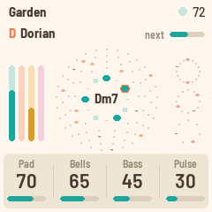
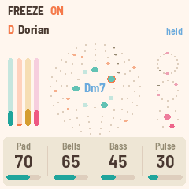

# Eno for the M-VAVE FM-1

Eno turns the M-VAVE FM-1 into a generative ambient machine, in the spirit of *Music for Airports*.
It plays itself from the moment it's switched on: breathing voices, soft bells on tape loops of
unequal length, a gliding bass and quiet Euclidean percussion, all through a short Echoplex-style
echo, a long tape loop and a plate reverb (after Eno's own chain for *Discreet Music*). You don't perform it, you tend it: pick a piece, a scale, take notes out, put them back, and
let it grow.

 

Private for now. Install it with `python3 tools/fm1_install.py build/eno.fwsc` (see below).

## The garden

- **Pad**: four breathing voices. Each swells in, hangs and fades on its own cycle (unequal lengths,
  about 12 to 20 s, as the tape loops of "2/1"), taking its note of the chord as it starts, so the
  chord forms and dissolves rather than sitting there. Two colours, chosen by the piece: a filtered
  Rhodes that blooms brighter as it swells, or sung voices (**ENV** switches) (**Bright** moves the vowel from "oo" to
  "eh"). Both go through a dark low-pass, then into the echoes and the plate, which are most of what you
  hear. **Swell** sets how long the breaths
  are. Every so often (**Drift**, 20 s to 5 min) the chord moves
  to another one in the scale, each voice the shortest way.
- **Bells**: FM bells (at a low **Bell tone**, soft-struck like a piano slowed to half speed) played by four tape loops 13, 17, 23 and 29 beats long. Each holds a few
  notes, so the loops slide against each other and the melody never quite repeats. **Density** sets
  how many notes a loop holds; **Evolve** how often a note changes or moves. Each loop is its own
  shade of bell, and now and then a note rings with its octave.
- **Bass**: the chord's root, low and soft, sometimes leaning on the fifth.
- **Pulse**: a soft thump, a closed hi-hat and an open one, each on its own Euclidean pattern over 16, 12
  and 7 sixteenths: polyrhythms. **Hits** sets how many; the patterns slowly turn and gain or lose
  a hit around it.

Over it all:

- **The arc**: a slow tide, a few minutes from end to end, between sparse (fewer bells, a darker
  vowel, the pulse gone, more reverb) and full. **Motion** sets how far it goes (and how far the
  smaller things wander: pitch, pan, the vowel, the echo's wow).
- **Rests**: with **Evolve**, the pulse sits out a few bars, the bass a chord, a bell loop a pass.

Everything follows one scale and one chord; the thump is tuned to the chord's root, and the hats
have no pitch.

## The pieces

**PRESETS** picks one of eight pieces: recipes for the whole garden (layers, timbre, tempo, key and
mode, how busy it is and how far it moves). Each remembers how you left it; hold **SAVE** for 1.5 s to
put the piece back to its recipe. Tune and MIDI out are the same for all.

| Piece | |
|---|---|
| Garden | D Dorian, 72: everything, gently |
| Departures | C# Ionian, 60: soft, slowed-piano bells an octave down over a quiet Rhodes, as "1/1" |
| Voices | F Aeolian, 56: only the sung "ah" voices on unequal loops and a low bass, as "2/1" |
| Afternoon | G Lydian, 84: bright vowels, busier bells, a light pulse |
| Night Bus | A Aeolian, 96: the pulse forward, metallic bells, short echoes |
| Shoreline | E pentatonic major, 64: dark, round bells lost in long echoes, as "2/2" |
| Glass | Eb pentatonic minor, 76: clangy bells an octave up, dense |
| Tides | Bb Mixolydian, 70: the most changeable (Evolve and Motion high) |

## Playing

| | |
|---|---|
| Keys | The scale. Each key adds its note to the scale, or takes it out (the keys light up for the notes in it). The root stays, and the scale keeps at least three notes. |
| PLAY | Grow / rest. Eno starts growing by itself at power-on; at rest, the sounds fade out slowly. |
| ARP | The next chord (on the next bar). |
| REC | **Freeze**: the chord holds and the reverb rings on forever, while the bells and pulse go on dry above it. Press again to thaw. |
| OCT− / OCT+ | The bells' octave. |
| ENV | The pad's colour: Rhodes or Voices (lit: Voices). Each piece keeps its own. |
| SELECT | Tempo (30–120). |
| ALGORITHM | Mode: Ionian, Dorian, Phrygian, Lydian, Mixolydian, Aeolian, pentatonic major and minor. Editing the scale with the keys makes it Custom. |
| PRESETS | The piece. |
| KNOB 1–4 | The four values on the screen. |
| SAVE | Saves (all the pieces). Eno also saves by itself a few seconds after a change, but only while resting (writing the flash interrupts the sound for a moment). Held 1.5 s: the piece back to its recipe. |

### The pages

Each page puts four values on KNOB 1–4. EDIT steps through the pages.

- **HOME: Layers.** Pad, Bells, Bass, Pulse: the four layers' levels.
- **SEQ: Motion.** Density, Evolve, Drift, Hits.
- **FX: Space.** Echo (send), Echo time (the tape loop: a dotted quarter to 4 bars, shortened to fit
  its 5.6 s), Reverb (send), Size (the plate's decay, up to a long hall, and the tape's feedback). The
  tape has two heads (the right one plays three quarters of the loop), and each repeat comes back
  darker and thinner.
- **SEL: Tone.** Bright (the voices' vowel), Swell (how long the voices breathe), Bell tone (round to
  metallic), Motion (how far the arc and the slow random movements go).
- **GLO: Setup.** Root, Tune, MIDI out, Lights (and the audio load, top right). Lights On: the key lights, and the unlit buttons glow dimly so they can be read; Keys: the key lights only; Off.

The screen: the piece, its root and mode at the top; the twelve notes as a ring (the scale lit, the chord bright, the root in coral) with the
chord's name in it; the four bell loops around it, their notes on them and their playheads going
round; the three pulse patterns on the right; the four layers' levels on the left; the way to the next
chord at the top right.

### MIDI

In over USB and the TRS jack, out over USB.

- **In, channel 1:** a note adds or removes its note from the scale, like a key.
- **In, clock:** the grid follows MIDI clock and start / stop.
- **Out** (on by default): the pad's chord on channel 1, the bells on 2, the bass on 3, the pulse on
  10, and clock with start / stop when Eno runs on its own tempo.

## The web app

The same engine also runs as a web app for phone and desktop (`web/app/`): the garden ring as the
instrument (tap a note to change the scale), the eight pieces as cards, the knobs as labelled sliders,
each piece remembered in the browser.

```
web/app/build.sh              # build/app: a static folder (index.html, worklet.js, eno.wasm), servable as is
python3 web/app/make_artifact.py   # build/app-artifact: the same as one page, for a private claude.ai Artifact
```

## Building and testing

The toolchain is the same as X0X's (see [BUILDING.md](BUILDING.md)):

```
tests/run_tests.sh      # the instrument, the platform pieces, the app in a simulator
./build.sh              # build/eno.fwsc
python3 tools/fm1_install.py build/eno.fwsc     # install it over USB
```

`build/host/eno_host SCRIPT OUTDIR` runs the whole app on a computer from a script
(`tests/scenarios/*.eno`), with audio and screenshots coming out. `web/emu/build.sh` builds the
same code for the browser.

## Credits

The idea comes from Brian Eno's generative music: *Music for Airports*' tape loops of unequal length.
The reverb is Jon Dattorro's plate ("Effect Design, Part 1", JAES 1997), as in
[FoMni](https://github.com/charlesvestal/fm1-fomni); the Euclidean rhythms are Godfried Toussaint's
reading of Bjorklund's algorithm. The platform (hardware layer, USB, update loader, storage,
installer) is [Felucca](https://github.com/hugelton/Felucca)'s by Leo Kuroshita (Hügelton
Instruments), by way of [X0X](https://github.com/charlesvestal/fm1-x0x) and FoMni. The idea of
running FM-1 firmware in the browser comes from [Groove OS](https://www.groove-os.com/).
GPL-3.0-only; see [LICENSING.md](LICENSING.md).
